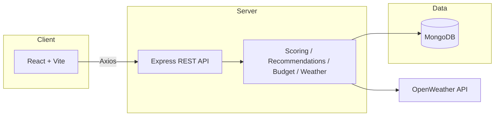

# HeatSafe (SunScape Metrics)

HeatSafe is a heat-risk assessment and mitigation planning system for campuses, schools, housing societies, offices, and similar institutions. It converts observations about outdoor spaces into an explainable, prioritized list of possible cooling interventions and budget-aware action plans.

**This is a planning and decision-support tool.** It is not a certified safety assessment and does not predict exact temperatures at individual courtyards.

## Problem statement

Outdoor areas can become uncomfortable or hazardous in hot weather. Institutions may not know which spaces to improve first, which interventions fit local conditions, or how to allocate a limited budget.

## Objectives

- Register sites and outdoor areas
- Compute transparent relative heat-concern scores (0–100)
- Show weather as contextual information (optional)
- Recommend rule-based interventions with illustrative INR costs
- Build action plans, suggest budget-fitting combinations, and track progress

## Features

- Site CRUD with search, filters, and maps
- Outdoor area assessments with backend scoring
- Recommendations engine driven by assessment inputs
- Budget planner (INR) with totals and heuristic “suggest within budget”
- Progress tracker with status, notes, and dates
- Dashboard with live API metrics, Recharts, Leaflet map, optional weather

## Technology stack

| Layer | Technologies |
|--------|----------------|
| Frontend | HTML5, CSS3, Bootstrap 5, React 18, Vite, React Router, Axios, Recharts, Leaflet / React-Leaflet |
| Backend | Node.js, Express (ES modules), REST, Mongoose |
| Database | MongoDB (local or Atlas via `MONGODB_URI`) |
| External | OpenWeather (server-side only), OpenStreetMap tiles |

## System architecture



## Project structure

```
heatsafe/
  client/          # React frontend
  server/          # Express API, models, services, seed
  package.json     # concurrently dev script
  README.md
```

## Data models (overview)

- **Site** — institution property and coordinates
- **Assessment** — outdoor area inputs, `riskScore`, `riskLevel`, `scoreFactors`
- **Intervention** — catalog of mitigation options and cost ranges
- **ActionPlan** — site budget and line items with status and costs

## Scoring algorithm (v1.0)

Weights (observations only — **weather is not included**):

| Factor | Weight |
|--------|--------|
| Shade deficiency (100 − shade %) | 30% |
| Surface concern (material lookup) | 25% |
| Exposure (Low/Med/High → 25/60/100) | 20% |
| Usage intensity | 15% |
| Vegetation deficiency | 10% |

Severity bands: 0–29 lower, 30–49 moderate, 50–69 high, 70–100 very high.

### Limitations

- Relative planning priority, not measured microclimate or medical risk
- Cost estimates are illustrative; verify locally
- Demo-grade JWT authentication (register/login); not hardened for production use

## REST API

Base URL: `http://localhost:5000/api`

| Method | Path |
|--------|------|
| GET | `/health` |
| GET/POST | `/sites`, `/sites/:id` |
| PUT/DELETE | `/sites/:id` |
| GET/POST | `/assessments`, `/assessments/:id` |
| GET | `/assessments/:id/recommendations` |
| GET | `/weather/current?lat=&lon=` |
| GET | `/weather/forecast?lat=&lon=` |
| GET/POST | `/interventions`, `/interventions/:id` |
| GET/POST | `/action-plans`, `/action-plans/:id` |
| POST | `/action-plans/:id/suggest-budget` |
| GET | `/dashboard/summary`, `/dashboard/risk-distribution`, `/dashboard/recent-activity` |

## Prerequisites

- Node.js 18+
- MongoDB 6+ (local) or MongoDB Atlas cluster
- Optional: [OpenWeather](https://openweathermap.org/api) API key (free tier)

## MongoDB local setup

1. Install MongoDB Community Edition and start `mongod`.
2. Default URI: `mongodb://127.0.0.1:27017/heatsafe`

## MongoDB Atlas setup

1. Create a free cluster at [mongodb.com/atlas](https://www.mongodb.com/atlas).
2. Create a database user and allow your IP (or `0.0.0.0/0` for dev only).
3. Copy the connection string into `MONGODB_URI`.

## OpenWeather setup

1. Sign up and create an API key.
2. Set `OPENWEATHER_API_KEY` in `server/.env` only (never in the client).

## Environment variables

**server/.env** (copy from `server/.env.example`):

```
PORT=5000
NODE_ENV=development
MONGODB_URI=mongodb://127.0.0.1:27017/heatsafe
CLIENT_URL=http://localhost:5173
OPENWEATHER_API_KEY=your_openweather_api_key
```

**client/.env** (copy from `client/.env.example`):

```
VITE_API_BASE_URL=http://localhost:5000/api
```

## Installation

```bash
cd heatsafe
npm install
npm run install:all
```

Copy `.env.example` files to `.env` in both `server` and `client`.

## Run development

From `heatsafe/`:

```bash
npm run dev
```

- API: http://localhost:5000  
- UI: http://localhost:5173  

Or run separately: `npm run dev:server` / `npm run dev:client`.

## Seed demo data

With MongoDB running and `server/.env` configured:

```bash
npm run seed
```

Demo records are tagged with `[DEMO]` and `isDemo: true`. Re-running seed removes previous demo sites (and linked assessments/plans) before inserting fresh demo data.

To clear demo data manually, delete documents where `isDemo: true` on `Site`, or drop the `heatsafe` database in development.

## Tests and build

```bash
npm test          # server tests (scoring, budget, validators, API integration*)
npm run build     # production client build
```

\* API integration tests require a reachable `MONGODB_URI` (same as runtime). They are skipped automatically if the variable is unset.

### Verified in this workspace (2026-10-20)

| Check | Result |
|--------|--------|
| `npm test` (server) | **14/14 passed** (unit + MongoDB integration) |
| `npm run build` (client) | **Succeeded** (Vite production build) |
| `npm run seed` | **Succeeded** (demo site, 4 assessments, catalog, action plan) |
| API server start | **Succeeded** (`database: connected` on `/api/health`) |
| OpenWeather live data | **Not verified** (no API key configured; graceful fallback verified) |
| Manual browser UI pass | **Not run in CI** — start with `npm run dev` and exercise dashboard flows locally |

### Acceptance checklist (implementation status)

| Item | Status |
|------|--------|
| Frontend / backend start | Implemented; backend verified; use `npm run dev` for UI |
| MongoDB persistence | Verified with local URI + seed |
| Sites CRUD | Implemented + API integration |
| Assessments + backend scoring | Implemented + tests |
| Recommendations vary by inputs | Verified via API smoke test |
| Weather degrades without key | Verified (integration test) |
| Leaflet map | Implemented (dashboard, sites, site detail, assessment picker) |
| Action plans + budget math | Implemented + budget tests |
| Progress tracking | Implemented (persists via action plan items) |
| Dashboard from API | Implemented + integration test |
| Demo data labeled | `[DEMO]` / `isDemo` on seed records |
| README | This file |
| Production build | Verified |

## Troubleshooting

| Issue | Action |
|--------|--------|
| `MONGODB_URI is not defined` | Create `server/.env` from `.env.example` |
| Frontend network errors | Ensure server is on port 5000 and `VITE_API_BASE_URL` matches |
| Weather unavailable | App works without a key; configure `OPENWEATHER_API_KEY` for live data |
| Cannot delete site | Remove linked assessments and action plans first |

## Future enhancements

- User authentication and multi-tenant workspaces
- PDF export of action plans
- Historical weather aggregates
- GIS import for campus footprints

---

**SunScape Metrics · HeatSafe** — demonstration/education project.
